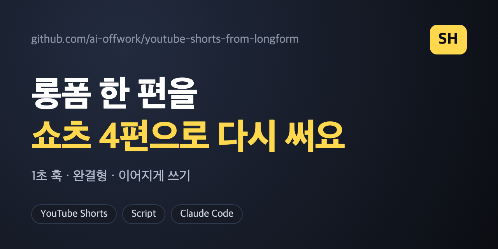

# youtube-shorts-from-longform



롱폼 영상 대본 한 편을 **완결형 쇼츠 4편(45~75초)** 으로 다시 쓰는 **Claude Code / 에이전트 스킬**입니다. 롱폼을 줄이는 게 아니라 가장 놀라운 대목 하나만 떼어 처음부터 다시 씁니다.

## 담긴 내용
- 1초 훅, 긴장, 알맹이, **한 방으로 닫는 완결형** 구조 (문장 10~16개, 300~450자)
- 쇼츠 제목·화면 위 헤더·썸네일 글 규칙(나쁜 예와 좋은 예 포함)
- **이어지게 쓰기**: 쇼츠만 보는 사람이 이해되도록 고리를 메우는 법
- 네 편을 서로 다른 대목에서 고르는 법, 화면(장면) 고르기
- 내기 전 점검: 사실과 정확히 맞는가, 소리 내어 읽어도 매끄러운가

## 설치 (Claude Code)
**방법 1. 명령 한 줄** — 모든 프로젝트에서 쓰려면:
```bash
mkdir -p ~/.claude/skills/youtube-shorts-from-longform && curl -fsSL https://raw.githubusercontent.com/ai-offwork/youtube-shorts-from-longform/main/SKILL.md -o ~/.claude/skills/youtube-shorts-from-longform/SKILL.md
```
특정 프로젝트에서만 쓰려면 `~/.claude/skills` 대신 그 프로젝트의 `.claude/skills`에 넣으세요. 설치 후 **새 세션**을 시작하면 인식됩니다.

**방법 2. Claude에게 맡기기** — Claude Code에 이렇게 말하면 파일을 받아 설치해 줍니다(Claude가 파일 받기·쓰기를 허용받은 경우).
> `https://raw.githubusercontent.com/ai-offwork/youtube-shorts-from-longform/main/SKILL.md` 를 `~/.claude/skills/youtube-shorts-from-longform/SKILL.md`로 설치해줘

**방법 3. 직접 복사** — 이 저장소를 받아 `SKILL.md`를 `~/.claude/skills/youtube-shorts-from-longform/`에 넣으면 됩니다.

설치 확인: Claude Code에서 `/youtube-shorts-from-longform`을 입력하거나 "이 대본으로 쇼츠 4편 만들어 줘"처럼 요청해 보세요. 다른 에이전트라면 `SKILL.md`를 시스템 프롬프트로 넣으면 됩니다. claude.ai 채팅에서는 설정의 스킬 업로드(zip)를 쓰는 방식이라 메뉴 이름이 바뀔 수 있으니 안내 문서를 확인하세요.

## 쓰는 법
"이 대본으로 쇼츠 4편 만들어 줘"라고 롱폼 대본과 함께 요청하세요. 함께 쓰면 좋은 스킬: [youtube-explainer-script](https://github.com/ai-offwork/youtube-explainer-script).

## 주의
- 새 사실을 만들지 않도록 되어 있습니다(대본에 있는 숫자·인과만). 그래도 공개 전에 사실을 확인하세요.

## 만든 곳
인스타 [@ai.offwork.kr](https://www.instagram.com/ai.offwork.kr/) — AI 업무 꿀팁

## 고지
- 개인이 만든 **비공식 프로젝트**이며 Anthropic(Claude, Claude Code), Google(YouTube)과 제휴·후원·승인 관계가 없습니다. 각 이름은 해당 회사의 상표이며, 여기서는 사용 가능한 도구로 언급할 뿐입니다.
- **AI가 쓴 대본·그림은 사람이 검수·편집해서 쓰세요.** 유튜브는 사람의 가공 없이 대량 제작된 반복 콘텐츠("inauthentic content")에 수익화 제재를 하고, 사실적으로 바꾸거나 합성한 콘텐츠는 공개 시 표시하도록 요구합니다. 최신 정책은 유튜브 공식 도움말에서 확인하세요.
- 사실 확인은 사용자의 책임입니다. 다른 채널의 영상·대본을 베끼지 마세요.

## 라이선스
MIT
